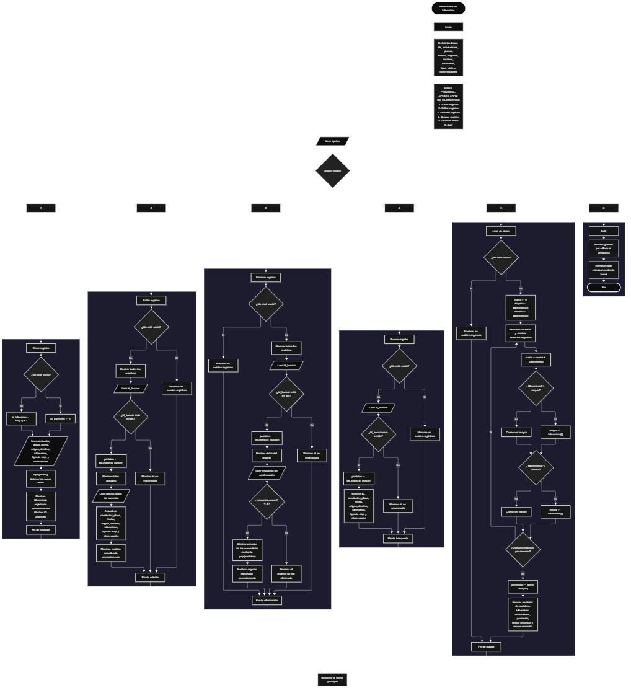

 

Este proyecto, llamado <b>acumulador de kilómetros</b>, fue desarrollado en <b>python</b> como un ejercicio práctico para fortalecer la lógica de programación mediante la creación de un sistema de gestión de recorridos vehiculares desde la consola. El programa cuenta con un menú principal de seis opciones que permite <b>crear, editar, eliminar, buscar y listar registros de kilometraje</b>, además de consultar estadísticas sobre las distancias recorridas. Cada registro almacena información como el nombre del conductor, la placa del vehículo, la fecha del recorrido, el origen, el destino, los kilómetros recorridos, el tipo de viaje y las observaciones. Para organizar los datos, se utilizan nueve listas paralelas que mantienen relacionada la información de cada recorrido durante la ejecución del programa. Durante su desarrollo se aplicaron conceptos fundamentales de programación, como variables, listas, estructuras condicionales, ciclos repetitivos, búsqueda mediante identificadores, operaciones aritméticas y métodos para agregar y eliminar elementos. Este proyecto permite poner en práctica los conocimientos adquiridos en Python y sirve como base para desarrollar sistemas de gestión de kilometraje más completos.

<h2 align="center">⚙️ Funcionamiento del menú principal</h2>

### ➕ Crear registro

La opción <b>1) crear registro</b> permite registrar un nuevo recorrido vehicular en el sistema. Antes de solicitar los datos, el programa comprueba si la lista <b>ids</b> está vacía mediante la condición <b>len(ids) == 0</b>. Si no existen registros, asigna el identificador <b>1</b> a la variable <b>id_kilometro</b>. En caso contrario, genera el siguiente identificador sumando uno al último elemento almacenado en la lista <b>ids</b>, utilizando la expresión <b>ids[-1] + 1</b>. Después, solicita el nombre del conductor, la placa del vehículo, la fecha del recorrido, el origen, el destino, los kilómetros recorridos, el tipo de viaje y una observación. El valor correspondiente a los kilómetros se convierte a un número decimal mediante <b>float()</b>. Finalmente, agrega el identificador y los ocho datos del recorrido a sus respectivas listas mediante el método <b>append()</b> y muestra los mensajes <b>"kilometraje registrado correctamente."</b> y <b>"id:"</b>, acompañados del identificador asignado.

### ✏️ Editar registro

La opción <b>2) editar registro</b> permite modificar la información de un recorrido que ya se encuentra registrado. Primero, el programa comprueba si la lista <b>ids</b> está vacía. Si no existen registros, muestra el mensaje <b>"no existen registros."</b>. En caso contrario, presenta los recorridos almacenados mediante un ciclo <b>for</b>, mostrando el identificador, el conductor, la placa, la fecha, el origen, el destino, los kilómetros, el tipo de viaje y las observaciones. Después, solicita el identificador del registro que se desea editar y convierte el valor introducido a entero mediante <b>int()</b>. Si el identificador se encuentra en la lista <b>ids</b>, utiliza <b>ids.index(id_buscar)</b> para obtener su posición y mostrar los datos actuales. A continuación, solicita los nuevos valores de todos los campos del recorrido, excepto el identificador, y actualiza directamente los elementos correspondientes de las listas. Los kilómetros nuevos se convierten a un valor decimal mediante <b>float()</b>. Finalmente, muestra el mensaje <b>"registro actualizado correctamente."</b>. Si el identificador no existe, presenta el mensaje <b>"id no encontrada."</b>.

### 🗑️ Eliminar registro

La opción <b>3) eliminar registro</b> permite eliminar un recorrido mediante su identificador. Antes de comenzar, el programa comprueba si existen registros almacenados en la lista <b>ids</b>. Si no hay información registrada, muestra el mensaje <b>"no existen registros."</b>. Si existen recorridos, presenta la lista completa mediante un ciclo <b>for</b> y solicita el identificador que se desea eliminar. Cuando encuentra el identificador, utiliza <b>ids.index(id_buscar)</b> para obtener la posición correspondiente y muestra los datos del recorrido seleccionado. Después, solicita confirmación mediante la pregunta <b>"¿desea eliminar este registro? (s/n):"</b>. La respuesta se convierte a mayúsculas utilizando <b>upper()</b> y se compara con el valor <b>"S"</b>. Si la confirmación es afirmativa, el programa utiliza el método <b>pop(posicion)</b> para eliminar los elementos correspondientes de las nueve listas: <b>ids, conductores, placas, fechas, origenes, destinos, kilometros, tipos_viaje y observaciones</b>. Finalmente, muestra el mensaje <b>"registro eliminado correctamente."</b>. Si el usuario no confirma la operación, presenta el mensaje <b>"el registro no fue eliminado."</b>. Si el identificador no existe, muestra <b>"id no encontrada."</b>.

### 🔎 Buscar registro

La opción <b>4) buscar registro</b> permite localizar un recorrido utilizando su identificador. Primero, el programa comprueba si existen registros en la lista <b>ids</b>. Si está vacía, muestra el mensaje <b>"no existen registros."</b>. En caso contrario, solicita el identificador del recorrido y convierte el valor introducido a entero mediante <b>int()</b>. Después, comprueba si el identificador se encuentra en la lista <b>ids</b>. Si existe, utiliza <b>ids.index(id_buscar)</b> para obtener la posición del registro y muestra toda su información: identificador, conductor, placa, fecha, origen, destino, kilómetros recorridos, tipo de viaje y observaciones. Si el identificador no está registrado, presenta el mensaje <b>"id no encontrada."</b>. Esta operación facilita consultar un recorrido específico sin necesidad de revisar individualmente todos los datos de la lista.

### 📋 Lista de datos

La opción <b>5) lista de datos</b> permite visualizar todos los recorridos registrados y calcular estadísticas relacionadas con los kilómetros recorridos. Primero, el programa comprueba si existen registros en la lista <b>ids</b>. Si no hay información almacenada, muestra el mensaje <b>"no existen registros."</b>. Si existen recorridos, inicializa la variable <b>suma</b> con el valor <b>0</b>, mientras que las variables <b>mayor</b> y <b>menor</b> reciben como valor inicial el primer elemento de la lista <b>kilometros</b>. A continuación, utiliza un ciclo <b>for</b> para recorrer los registros y mostrar la información completa de cada recorrido. Durante el recorrido, acumula las distancias en la variable <b>suma</b> y compara los kilómetros de cada registro para determinar el mayor y el menor recorrido. Al finalizar, calcula el promedio mediante la expresión <b>suma / len(ids)</b> y redondea el resultado a dos decimales con <b>round(promedio, 2)</b>. Finalmente, presenta la cantidad de registros, los kilómetros acumulados, el promedio de kilómetros, el mayor recorrido y el menor recorrido. Estas estadísticas permiten conocer de forma general las distancias registradas en el sistema.

### 🚪 Salir del menú principal

La opción <b>6) salir</b> permite finalizar la ejecución del programa. Cuando el usuario selecciona esta opción, el programa muestra el mensaje <b>"gracias por utilizar el programa."</b> y ejecuta la instrucción <b>break</b>, que interrumpe el ciclo principal <b>while True</b>. De esta manera, el menú deja de repetirse y el programa termina su ejecución. Esta opción proporciona una salida directa del sistema después de realizar las operaciones necesarias para administrar los recorridos vehiculares.

<h2 align="center">🧠 Temas aplicados en el proyecto</h2>

### 📦 Variables

En este proyecto se utilizan variables para almacenar los identificadores de los recorridos, los datos introducidos por el usuario, la opción seleccionada en el menú, la posición de un registro, los valores empleados en las estadísticas y las respuestas de confirmación. Cada variable cumple una función específica dentro de las operaciones de creación, edición, eliminación, búsqueda y listado de los registros.

🔢 **Opcion:** Almacena la opción seleccionada por el usuario en el menú principal.

🆔 **Id_kilometro:** Almacena el identificador que se asigna al nuevo recorrido.

🔎 **Id_buscar:** Almacena el identificador introducido por el usuario para localizar un registro.

📍 **Posicion:** Indica el índice del registro encontrado dentro de las listas.

📏 **Kilometro:** Almacena los kilómetros recorridos durante un viaje.

🔄 **Suma:** Acumula los kilómetros de todos los recorridos registrados.

📈 **Mayor:** Almacena el mayor valor de kilómetros encontrado durante el cálculo de estadísticas.

📉 **Menor:** Almacena el menor valor de kilómetros encontrado durante el cálculo de estadísticas.

📊 **Promedio:** Almacena el resultado de dividir los kilómetros acumulados entre la cantidad de registros.

🔁 **I:** Funciona como contador en los ciclos <b>for</b> utilizados para recorrer las listas y mostrar los registros.

✅ **Respuesta:** Almacena la confirmación del usuario antes de eliminar un recorrido.

### 🗃️ Listas

En este proyecto se utilizan nueve listas paralelas para almacenar los datos de los recorridos vehiculares. Cada lista mantiene un tipo de información y todas utilizan la misma posición para representar los datos correspondientes a un mismo registro. Por ejemplo, los elementos ubicados en la posición <b>0</b> de las nueve listas representan el primer recorrido almacenado. Esta organización permite acceder a la información mediante un identificador, modificar los datos de un recorrido, eliminar sus elementos correspondientes y recorrer los registros para obtener estadísticas. A diferencia de los arreglos de tamaño fijo, las listas utilizadas en Python pueden aumentar o disminuir su cantidad de elementos durante la ejecución.

🆔 **Ids:** Almacena los identificadores de los recorridos registrados.

👤 **Conductores:** Almacena los nombres de los conductores.

🚘 **Placas:** Almacena las placas de los vehículos.

📅 **Fechas:** Almacena las fechas de los recorridos.

📍 **Origenes:** Almacena los lugares de origen de los viajes.

🏁 **Destinos:** Almacena los lugares de destino de los viajes.

📏 **Kilometros:** Almacena las distancias recorridas como números decimales.

🛣️ **Tipos_viaje:** Almacena el tipo de viaje realizado.

📝 **Observaciones:** Almacena las observaciones relacionadas con cada recorrido.

### 🔀 Estructuras condicionales

En este proyecto se utilizan las estructuras <b>if</b>, <b>elif</b> y <b>else</b> para controlar el funcionamiento del menú principal y las diferentes operaciones. Estas condiciones permiten determinar qué opción ha seleccionado el usuario, comprobar si existen registros antes de ejecutar una operación, verificar si un identificador está almacenado en la lista <b>ids</b> y decidir si se confirma la eliminación de un recorrido. También se utilizan para comparar las distancias y determinar los valores correspondientes al mayor y al menor recorrido. Gracias a estas estructuras, el programa puede responder de manera diferente según los datos almacenados y las decisiones del usuario.

### 🔄 Estructuras repetitivas

En este proyecto se utilizan los ciclos <b>while</b> y <b>for</b>. El ciclo <b>while True</b> mantiene activo el menú principal y permite ejecutar las diferentes operaciones hasta que el usuario selecciona la opción de salida, que utiliza <b>break</b> para finalizar el ciclo. Por otro lado, los ciclos <b>for</b> permiten recorrer la lista de identificadores y mostrar los datos correspondientes de cada registro durante las operaciones de edición, eliminación y listado. También facilitan presentar los recorridos antes de seleccionar uno para modificarlo o eliminarlo. Estas estructuras permiten procesar varios registros sin necesidad de repetir manualmente las mismas instrucciones.

### 🎯 Selección de opciones del menú

El programa utiliza una cadena de condiciones <b>if, elif y else</b> para evaluar el valor almacenado en la variable <b>opcion</b>. Cada condición corresponde a una operación del sistema: crear, editar, eliminar, buscar, listar datos o salir. Cuando el valor introducido coincide con una opción válida, se ejecutan las instrucciones correspondientes. Si el usuario introduce un valor que no coincide con ninguna de las seis opciones, se ejecuta el bloque <b>else</b> y se muestra el mensaje <b>"opción inválida."</b>. Esta estructura permite organizar el menú principal y dirigir la ejecución hacia cada operación.

### 🔍 Búsqueda mediante identificadores

La búsqueda de registros se realiza mediante los métodos y operadores <b>in</b> e <b>index()</b>. Primero, el programa comprueba si el identificador introducido se encuentra en la lista <b>ids</b> utilizando la expresión <b>id_buscar in ids</b>. Si existe, utiliza <b>ids.index(id_buscar)</b> para obtener la posición del identificador y acceder a los datos correspondientes en las demás listas. Este procedimiento se aplica en las operaciones de edición, eliminación y búsqueda. De esta forma, el identificador funciona como referencia para localizar el recorrido que se desea consultar o modificar.

### 🧰 Métodos de listas

El programa utiliza diferentes operaciones de Python para administrar los elementos de las listas. El método <b>append()</b> agrega los datos de un nuevo recorrido al final de cada lista. El método <b>pop(posicion)</b> elimina el elemento ubicado en la posición del registro seleccionado. Por otro lado, <b>index()</b> permite obtener la posición de un identificador y el operador <b>in</b> comprueba si dicho identificador existe. También se utiliza <b>len()</b> para conocer la cantidad de registros almacenados y comprobar si las listas están vacías. Estas operaciones facilitan la administración de los datos durante la ejecución del programa.

### 🔢 Conversión de tipos de datos

En este proyecto se utilizan las funciones <b>int()</b> y <b>float()</b> para convertir los datos introducidos por el usuario al tipo numérico requerido. La función <b>int()</b> se emplea para convertir el identificador del registro a un número entero, mientras que <b>float()</b> permite almacenar los kilómetros recorridos como un número decimal. Esto posibilita registrar distancias que incluyen valores fraccionarios. Sin embargo, el programa no incorpora un manejo de excepciones para controlar las entradas que no puedan convertirse a los tipos numéricos esperados.

### 📊 Operaciones aritméticas y estadísticas

El programa utiliza operaciones aritméticas para calcular las estadísticas de los recorridos registrados. La variable <b>suma</b> acumula los kilómetros mediante la expresión <b>suma += kilometros[i]</b>. Las variables <b>mayor</b> y <b>menor</b> se actualizan mediante comparaciones condicionales que permiten identificar las distancias más alta y más baja. El promedio se obtiene dividiendo la suma de los kilómetros entre la cantidad de registros mediante <b>suma / len(ids)</b>. Finalmente, se utiliza <b>round(promedio, 2)</b> para mostrar el promedio redondeado a dos decimales. Estas operaciones proporcionan un resumen estadístico de las distancias registradas.

### 🆔 Generación de identificadores

El sistema genera automáticamente un identificador para cada nuevo recorrido. Cuando la lista <b>ids</b> está vacía, el primer identificador es <b>1</b>. Cuando ya existen registros, el programa obtiene el último identificador almacenado mediante <b>ids[-1]</b> y le suma uno. Este procedimiento permite asignar identificadores consecutivos durante el funcionamiento habitual del programa. Sin embargo, como el identificador depende del último elemento de la lista, eliminar el último registro puede provocar que el siguiente registro reutilice un identificador anterior. El código original no utiliza un contador independiente para conservar el último identificador generado.

<h2 align="center">¿Cómo se implementaron las operaciones crud en el proyecto?</h2>

Las operaciones <b>crud</b> se implementaron mediante las opciones del menú principal y permiten administrar los recorridos vehiculares almacenados en las listas. La operación <b>crear</b> corresponde a <b>crear registro</b>, donde se introducen los datos de un nuevo recorrido y se agregan a las nueve listas. La operación <b>leer</b> se realiza mediante las opciones <b>buscar registro y lista de datos</b>, que permiten consultar un recorrido específico o visualizar todos los registros y sus estadísticas. La operación <b>actualizar</b> corresponde a <b>editar registro</b>, donde se modifican los datos de un recorrido existente sin cambiar su identificador. Por último, la operación <b>eliminar</b> corresponde a <b>eliminar registro</b>, que permite retirar un recorrido de las nueve listas después de solicitar la confirmación del usuario. Estas operaciones utilizan listas, variables, estructuras condicionales, ciclos repetitivos y métodos de Python para administrar la información temporalmente.

<h2 align="center">Diagrama de flujo del proyecto</h2>

<h2 align="center">🛡️ Validaciones del programa</h2>

### 📭 No existen registros

Esta comprobación se utiliza en las opciones de <b>editar, eliminar, buscar y lista de datos</b>. El programa verifica si la lista <b>ids</b> está vacía mediante la condición <b>len(ids) == 0</b>. Cuando no existen registros, muestra el mensaje <b>"no existen registros."</b> y no continúa con la operación solicitada. Esta comprobación evita que las operaciones intenten localizar o procesar recorridos cuando no hay información almacenada.

### ❌ Identificador no encontrado

Esta comprobación se utiliza durante las operaciones de edición, eliminación y búsqueda. El programa verifica si el identificador introducido se encuentra en la lista <b>ids</b> mediante el operador <b>in</b>. Si existe, obtiene su posición utilizando <b>index()</b> y continúa con la operación correspondiente. Si no existe, muestra el mensaje <b>"id no encontrada."</b>. Esta comprobación permite identificar si el recorrido solicitado se encuentra registrado en el sistema.

### 🗑️ Confirmación de eliminación

Antes de eliminar un recorrido, el programa solicita confirmación mediante una pregunta que permite responder con <b>s</b> o <b>n</b>. La respuesta se convierte a mayúsculas con <b>upper()</b> y se compara con el valor <b>"S"</b>. Si la respuesta coincide, el programa elimina el registro de las nueve listas y muestra el mensaje <b>"registro eliminado correctamente."</b>. Si la respuesta es diferente de <b>"S"</b>, muestra el mensaje <b>"el registro no fue eliminado."</b>. El código original no comprueba específicamente que la respuesta sea únicamente <b>s</b> o <b>n</b>; cualquier otra entrada también evita la eliminación.

### ⚠️ Entradas numéricas

El programa convierte los identificadores introducidos por el usuario mediante <b>int()</b> y las distancias recorridas mediante <b>float()</b>. Sin embargo, no incluye estructuras <b>try/except</b> para manejar errores de conversión. Por este motivo, si el usuario introduce un valor no válido para el tipo numérico esperado, puede producirse una excepción y finalizar la ejecución del programa. Esta es una limitación del código original y no una validación implementada.

### 📏 Valores de kilómetros

El programa utiliza <b>float()</b> para almacenar los kilómetros recorridos, lo que permite introducir valores enteros o decimales. No obstante, el código original no comprueba que la distancia sea positiva ni impide introducir valores negativos. Las estadísticas utilizan directamente los valores almacenados en la lista <b>kilometros</b>, por lo que los resultados dependen de los datos que haya introducido el usuario.

### 🆔 Generación de identificadores

El programa asigna el identificador <b>1</b> cuando no existen registros y, posteriormente, suma uno al último identificador almacenado. Aunque este procedimiento permite generar identificadores de forma automática, el código no mantiene un contador independiente ni comprueba si el nuevo identificador ya fue utilizado anteriormente. Si se elimina el último registro, el siguiente identificador puede volver a utilizar un número previamente asignado.

### 🔗 Sincronización de las listas

El sistema distribuye la información de cada recorrido entre nueve listas paralelas. Por ello, las operaciones de creación, edición y eliminación deben mantener la correspondencia entre las posiciones de <b>ids, conductores, placas, fechas, origenes, destinos, kilometros, tipos_viaje y observaciones</b>. Al crear un recorrido, el programa agrega un elemento a cada lista; al editarlo, actualiza los valores de la misma posición; y al eliminarlo, utiliza <b>pop(posicion)</b> en todas las listas. Esta organización depende de que las operaciones mantengan sincronizada la información de cada recorrido.

### ⚠️ Opción inválida

El menú principal incluye una estructura condicional que evalúa las seis opciones disponibles. Si el usuario introduce un valor diferente de <b>1, 2, 3, 4, 5 o 6</b>, el programa ejecuta el bloque <b>else</b> y muestra el mensaje <b>"opción inválida."</b>. Después, el ciclo principal continúa y vuelve a mostrar el menú, permitiendo que el usuario seleccione otra opción.

<h2 align="center">🎯 Objetivo del proyecto</h2>

El objetivo principal de este proyecto es fortalecer la <b>lógica de programación</b> mediante el desarrollo de un sistema de gestión de recorridos vehiculares en <b>python</b>. A través de su construcción se busca aplicar los conocimientos adquiridos sobre variables, listas, estructuras condicionales, ciclos repetitivos, métodos de listas, búsqueda mediante identificadores y operaciones aritméticas. Además, el proyecto permite comprender cómo registrar, consultar, modificar y eliminar información, así como calcular estadísticas a partir de datos numéricos. De esta manera, se establece una base para desarrollar aplicaciones más completas destinadas a la administración de vehículos, recorridos y distancias, utilizando otros lenguajes y tecnologías.

